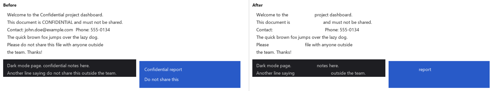

# PDFScript

Delete a word or sentence from **every page** of a PDF, even when the pages are screenshots or scans with no real text in them.

Give it a PDF and the text to remove. It reads each page with OCR, finds every match, and erases it by painting over it in the background colour around it. The rest of the page is left exactly as it was.



## Features

- **Works on screenshot and scanned PDFs**: pages are read with [RapidOCR](https://github.com/RapidAI/RapidOCR), so no text layer is needed.
- **Erases cleanly**: the colour is sampled behind each word, so text disappears on white, dark-mode, and coloured buttons or chat bubbles. Pixels are changed inside the page image itself, so the text is really gone, not hidden under a box.
- **Forgives OCR mistakes**: `Confidentia1` still matches `confidential`, and a sentence still matches when it wraps onto the next line.
- **Double-checks**: pages where something was erased are read a second time to catch anything missed.
- **Cleans the text layer too**: real text, and the invisible text some scanner apps add, is removed as well, so the deleted words can't be found with search or copy-paste.
- **Handles rotated pages, JPEG or PNG pages, and whole folders of PDFs**.
- **Runs offline** on your own machine. Nothing is uploaded.

## Installation

You need **Python 3.10 or newer**. It was tested with Python 3.13 on Windows 11.

```bash
git clone https://github.com/zhyarJB/PDFScript.git
cd PDFScript
pip install -r requirements.txt
```

## Quick start

Try it on the included sample first:

```bash
python remove_text.py test_sample.pdf -t "confidential" -t "do not share this"
```

Then open `D:\Qbank Question\test_sample_cleaned.pdf`. Your original file is never changed.

## Usage

### Window (easiest)

Double-click **`PDFScript.pyw`**. If it opens in a text editor instead, right-click it and choose *Open with → Python*.

1. Choose a PDF with **File...**, or a whole folder of PDFs with **Folder...**.
2. Type the words or sentences to delete, one per line.
3. Press **Preview** to see what would be deleted. Nothing is written.
4. Press **Remove text**, then **Open output folder** to find `NAME_cleaned.pdf`.

The window offers the most-used options: *Exact matches only*, *Fill colour* and the OCR *Language*. For the others (`--similarity`, `--dpi`, `--passes`, `--show-text`), use the command line. `PDFScript.pyw` must stay in the same folder as `remove_text.py`.

### Interactive

```bash
python remove_text.py
```

It asks for the PDF (you can drag the file into the terminal) and then for the words or sentences to delete, one per line. Press Enter on an empty line to start.

### Command line

```bash
# delete one word
python remove_text.py report.pdf -t "Confidential"

# delete several words and sentences at once
python remove_text.py report.pdf -t "do not share this" -t "John Doe" -t "555-0134"

# every PDF in a folder
python remove_text.py my_pdfs_folder -t "Draft"

# choose where to save the result
python remove_text.py report.pdf -t "Draft" -o clean/report.pdf
```

The result is saved as `NAME_cleaned.pdf` in `D:\Qbank Question` (created if missing), unless you pass `-o`. To change that folder, edit `OUTPUT_DIR` at the top of `remove_text.py`. Put paths that contain spaces in quotes.

### Recommended workflow for your own files

1. **Check what the OCR reads.** Nothing is written:
   ```bash
   python remove_text.py report.pdf --show-text
   ```
2. **Preview what would be deleted.** Nothing is written:
   ```bash
   python remove_text.py report.pdf -t "your word" --dry-run
   ```
3. **Delete it**, then open the `_cleaned.pdf` and check a few spots:
   ```bash
   python remove_text.py report.pdf -t "your word"
   ```

## Options

| Option | What it does |
|---|---|
| `-t`, `--text TEXT` | Word or sentence to delete. Repeat it for more than one. |
| `-o`, `--output PATH` | Output file (one input) or output folder (several inputs). Default: `D:\Qbank Question`. |
| `--dry-run` | Only list what would be deleted. Nothing is written. |
| `--show-text` | Print the text the OCR reads on each page. |
| `--exact` | Only delete exact matches, with no OCR-mistake tolerance. |
| `--similarity N` | How close a match must be, from 0 to 1. Default `0.85`. Lower it to catch more OCR mistakes. |
| `--fill COLOUR` | Colour to paint over deleted text: `auto` (default, matches the background), `white`, `black` or `#RRGGBB`. Use `black` for classic redaction bars. |
| `--lang LANG` | Use a language-specific OCR model: `en`, `latin`, `arabic`, `cyrillic`, `eslav`, `el`, `devanagari`, `ta`, `te`, `th`, `korean`, `ch`, `japan`, `ka` or `chinese_cht`. It is downloaded the first time you use it. |
| `--dpi N` | Resolution used for OCR. By default it matches the screenshot's own resolution. |
| `--passes N` | How many times a page is read. Default `2`; the second pass is a re-check. |

## How matching works

- **Case and punctuation are ignored**: `thanks` matches `Thanks!`.
- **Only whole words match**: `cat` does not delete `category`, and `share` does not delete `shared`.
- **Short words must match exactly.** Longer words and sentences may differ by about one letter in seven, to allow for OCR mistakes. Characters OCR often confuses (`0`/`O`, `1`/`l`/`I`) count as the same.
- **Sentences can continue onto the next line**, and still match when the OCR splits or merges words.
- Because matching is forgiving, a very similar phrase can match too. For example, `do not shave this` matches `do not share this`. Use `--dry-run` to check, and `--exact` to turn the tolerance off.

## How it works

1. Each page is rendered at the screenshot's own resolution and read with RapidOCR, which gives the position of every word.
2. The words are matched against your text, using the rules above.
3. Each match's box is fitted to the actual letters. The background colour is taken from around the letters, and the box is trimmed so it doesn't spill outside a button or bubble.
4. The pixels are painted over directly inside the page image. JPEG pages stay JPEG, so the file size stays about the same. Any text in the PDF's text layer at that spot is removed with [PyMuPDF](https://pymupdf.readthedocs.io/) redaction.
5. The page is read again to make sure nothing was missed.

## Limitations

- **On photos or gradients**, an erased spot becomes a flat patch of colour rather than being reconstructed.
- **Whole words are removed**, so punctuation attached to a word goes with it: deleting `shared` from `shared.` also removes the period.
- **The OCR runs on the CPU** and takes several seconds per page. Pages where something is erased are read twice.
- **Only PDFs are accepted.** To clean a PNG or JPG, put it in a PDF first.
- **Check the result** before you rely on it to hide sensitive information. OCR can miss text that is very small, blurry or stylised.

## Tests

```bash
python -m unittest -v
```

The tests run the real OCR on `test_sample.pdf` and take about a minute.

## Requirements

- [PyMuPDF](https://pypi.org/project/PyMuPDF/) 2.0 or newer
- [RapidOCR](https://pypi.org/project/rapidocr/) 3.10 or newer, with [onnxruntime](https://pypi.org/project/onnxruntime/)
- NumPy
